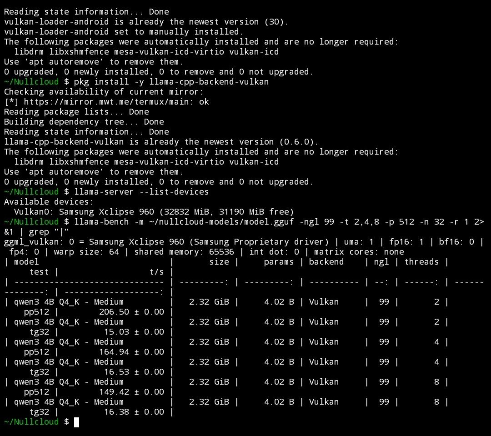

# Nullcloud — On-Device, No Cloud AI for Any Page or PDF

[](LICENSE)
[](#airplane-mode--offline-niche)
[](#everything-is-free) [](https://checkout.revolut.com/pay/044a268e-4869-4708-9b0f-8e302cc28c37)

> **AI that reads the web for you — without the web reading you.**
> Strictly **on-device, no cloud AI**. Summarize, fact-extract, translate, or question any web page, text selection, or PDF using a local model running on your own phone or computer. Works completely offline in **Airplane Mode**.

---

## Why Nullcloud Stands Out

1. **Own the "Airplane Mode" Niche (On-Device, No Cloud AI):**
   Unlike cloud wrappers, Nullcloud runs the LLM directly on your phone (`127.0.0.1`). Open an article, switch your phone to **Airplane Mode**, and stream a summary or ask questions with zero network connection. *(We never call this "air-gapped" because your phone connects to the internet when you browse—it is strictly **on-device, no cloud AI**.)*
2. **Android Share Sheet -> Instant Summary Notification (No Extension Needed):**
   In **any** Android browser or app, tap **Share -> Termux**, pick an action (*Summarize*, *Key facts*, *Claims check*, *Read aloud*), and receive a summary notification with **Copy** and **Open UI** buttons. No mobile browser extension required.
3. **Unified One-Command Setup (`bash setup.sh`):**
   A single setup command automatically detects Android Termux vs Desktop (macOS/Linux) and deploys all three entry points at once:
   - **Android Share Sheet** (`~/bin/termux-url-opener`)
   - **Web UI & Productivity Hub** (`http://127.0.0.1:8080` — works in any browser)
   - **Browser Extension** (Chrome, Brave, Edge, Firefox)
4. **GPU Offload on Android (Vulkan):**
   `termux/setup.sh` checks `/proc/meminfo`, picks `Llama-3.2-1B-Instruct Q4_K_M` (under ~5.5 GB RAM) or `Llama-3.2-3B-Instruct Q4_K_M` (6 GB+), and offloads layers to the GPU (`-ngl 99`). Tested on a Samsung **Exynos** phone with **GPU (Vulkan)**. Other phones may work but are not tested yet.
5. **Everything Is Free:** Library, PDF input, presets and Private Cloud are free for everyone. No license key, no paywall.

---

## Quick Start — Unified Setup

### Option A: Android Phone (Termux — Share Sheet + Web UI + Private Cloud)

**Requirements:** 4 GB+ RAM Android phone (~6 GB recommended for 3B model), ~2.5 GB free storage, Wi-Fi for the one-time model download.

1. Install **Termux** and **Termux:API** from **F-Droid** (not Play Store):
   - [Termux on F-Droid](https://f-droid.org/packages/com.termux/)
   - [Termux:API on F-Droid](https://f-droid.org/packages/com.termux.api/)
2. In Termux, run the unified setup command:
   ```bash
   pkg install -y git && git clone https://github.com/kukirin-ui/Nullcloud ~/nullcloud && bash ~/nullcloud/setup.sh
   ```
   *(To force the fast 1B model on any phone: `MODEL_TIER=1b bash ~/nullcloud/setup.sh`; to compile `llama.cpp` from source with full mobile Vulkan GPU shaders: `BUILD_VULKAN=1 bash ~/nullcloud/setup.sh`)*
3. Start Nullcloud:
   ```bash
   bash ~/nullcloud/termux/start.sh
   ```
4. **Use any of the 3 entry points:**
   - **Android Share Sheet:** In any app or browser, tap **Share -> Termux** -> pick **Summarize** -> get an on-device summary notification.
   - **Web UI:** Open `http://127.0.0.1:8080` in any browser on your phone, paste your token once, and run.
   - **Airplane Mode Test:** Open an article or paste text/PDF into the Web UI, turn on **Airplane Mode**, and press **Run On-Device**.
5. Set **Android Settings -> Apps -> Termux -> Battery -> Unrestricted** so Android does not kill background generation.

### Option B: Desktop (macOS / Linux / Windows)

1. Install [Ollama](https://ollama.com/download) and Python 3.
2. Run the unified setup & start script:
   - **macOS / Linux:** `bash setup.sh` (or `bash desktop/start.sh`)
   - **Windows:** `desktop\start.bat`
3. Load the Browser Extension:
   - Open `chrome://extensions` -> enable **Developer mode** -> **Load unpacked** -> select the `extension/` folder.
   - Open any web page (even offline in Airplane Mode), click **Nullcloud**, paste your token once, and click **Run on this page**.

---

## Performance

Tested on a Samsung Exynos phone (Xclipse 960 GPU) using GPU offload (Vulkan, packaged `llama-cpp-backend-vulkan`). Tune GPU offload layers (`-ngl`) in the Web UI (**Private Cloud & Services -> Hardware Tweaks**) or the browser extension.

Measured with `llama-bench -p 512 -n 32 -r 1` (Vulkan, `-ngl 99`) on a real phone:

| GPU | Model | Threads | Prompt (pp512) | Generation (tg32) |
|---|---|---|---|---|
| Samsung Xclipse 960 (Exynos) | Qwen3 4B Q4_K_M | **2** | **206.50 t/s** | 15.03 t/s |
| Samsung Xclipse 960 (Exynos) | Qwen3 4B Q4_K_M | 4 | 164.94 t/s | **16.53 t/s** |
| Samsung Xclipse 960 (Exynos) | Qwen3 4B Q4_K_M | 8 | 149.42 t/s | 16.38 t/s |



*Real llama-bench run on Samsung Xclipse 960 (Vulkan), Qwen3 4B Q4_K_M*

With full GPU offload, more CPU threads do not help: **`THREADS=2` is recommended** (fastest prompt reading, generation within 10%). `termux/start.sh` uses 2 threads by default when GPU offload is on; override with `THREADS=4 bash ~/nullcloud/termux/start.sh`.

Measure your own device: run `bash termux/bench.sh 20` in Airplane Mode with the charger unplugged. It prints real end-to-end tok/s and seconds per article. PRs with your results are welcome.

---

## Everything Is Free

Nullcloud is 100% free and open source under the **MIT License**. Every feature is included for everyone:

| Feature | Included |
|---|---|
| **On-Device, No Cloud AI** (Airplane Mode ready) | Yes |
| **Android Share Sheet -> Summary Notification** | Yes |
| **Web UI (`127.0.0.1:8080`) & Browser Extension** | Yes |
| **6 Built-In Modes** (Summary, Facts, Claims, ELI5, Translate, Ask) | Yes |
| **Read Aloud (TTS) & Markdown / Obsidian Export** | Yes |
| **Saved-Page Library with SQLite FTS5 Search** | Yes |
| **Offline PDF Input** | Yes |
| **Custom Prompt Presets** (Legal, Journalism, Clinical + your own) | Yes |
| **Private Cloud** (phone as AI server for your laptop over Tailscale) | Yes |

## Services (Optional, Paid)

The app is free. If you want someone to set it up for you, these are paid services:

| Service | Price | How to order |
|---|---|---|
| **Remote setup** (Termux, model, Share Sheet, Web UI on your phone or PC) | €30 | [Pay with Revolut](https://checkout.revolut.com/pay/ee0aad48-1ff6-452b-9470-01ae6db706a4) |
| **Setup + priority support** (remote setup + 30 days of priority email help) | €45 | [Pay with Revolut](https://checkout.revolut.com/pay/c60fa94d-e094-4c1f-aac4-ae04c4776c52) |
| **Private Cloud (Tailscale) setup** (phone + laptop, tested end to end) | €60-80 | Email [Pozun.alen96@gmail.com](mailto:Pozun.alen96@gmail.com) for a quote |
| **Team setup & consulting** | from €250 | Email [Pozun.alen96@gmail.com](mailto:Pozun.alen96@gmail.com) for a quote |

After paying, email [Pozun.alen96@gmail.com](mailto:Pozun.alen96@gmail.com) with the payment confirmation to book a time.

### Private Cloud: Use Your Phone as Your Laptop's AI Server (Free)

This uses [Tailscale](https://tailscale.com) (free for personal use), a private encrypted network between your own devices.

1. Install Tailscale on your phone and laptop and log in to the same account on both.
2. On your Android phone in Termux:
   ```bash
   TAILSCALE=1 bash ~/nullcloud/termux/start.sh
   ```
   Nullcloud binds to your phone's `100.x.y.z` Tailscale address. `llama-server` stays on `127.0.0.1:8081` and is never exposed.
3. On your laptop, open the Nullcloud browser extension -> **Compute & Private Cloud Settings** -> enter `http://<phone-tailscale-ip>:8080` and your token. Or open that address in a browser.

Note: if `tailscale` is not available inside Termux, Nullcloud keeps listening on `127.0.0.1` only. Set `HOST=<phone-tailscale-ip>` manually in that case.

### High-Compliance Consulting (Law Firms, Journalists, Medical Clinics)

Need turn-key deployment of **on-device, no cloud AI** for privileged legal discovery, investigative source protection, or clinical literature workflows?
- Read **[`docs/CONSULTING.md`](docs/CONSULTING.md)** for vertical presets, threat models, and deployment packages.
- See **[Services](#services-optional-paid)** above for prices.

---

## How Nullcloud Compares

| Capability | Nullcloud | Page Assist | Cloud AI Extensions |
|---|---|---|---|
| **Branding & Architecture** | **On-device, no cloud AI** | Local / Ollama | Cloud APIs |
| **Android Share Sheet -> Summary Notification** | **Yes (No extension needed)** | Not offered | Requires app/cloud |
| **Runs 100% Offline in Airplane Mode on Phone** | **Yes (Termux + 1B/3B GGUF)** | Desktop-focused | No |
| **Phone as Private Cloud Server over Tailscale** | **Yes (free)** | Manual | N/A |
| **Offline Saved-Page FTS5 Library & PDF Input** | **Yes (free)** | Chat history | Cloud-stored |
| **Markdown / Obsidian Vault Auto-Export** | **Yes (`NOTES_DIR`)** | No | No |

---

## Troubleshooting (Termux)

- **Install Termux from F-Droid, not the Play Store.** The Play Store build is outdated and `pkg` fails.
- **`pkg install` prints `Abort.`** The prompt was cancelled (no input or a stray key). Run it again with `-y`, for example `pkg install -y nodejs git python`.
- **Mirror / 404 errors during `pkg install`:** run `termux-change-repo`, pick a different mirror, then `pkg update -y && pkg upgrade -y`.
- **`No space left on device`:** the 3B model needs ~2 GB plus ~0.5 GB for tools. Free space or force the 1B model: `MODEL_TIER=1b bash ~/nullcloud/setup.sh`.
- **Model download stopped halfway:** run setup again. Partial `*.gguf.part` files are resumed or replaced.
- **Share -> Termux does nothing:** install **Termux:API** from F-Droid as well, run `pkg install -y termux-api`, and check that `~/bin/termux-url-opener` exists and is executable (`chmod +x ~/bin/termux-url-opener`).
- **Generation stops when the screen turns off:** Android Settings -> Apps -> Termux -> Battery -> **Unrestricted**, and run `termux-wake-lock`.
- **GPU is not used (`llama-bench` shows backend `CPU`, or start.sh says "CPU fallback"):** install the Vulkan backend and the Android Vulkan loader:
  ```bash
  pkg install -y llama-cpp llama-cpp-backend-vulkan
  pkg uninstall -y vulkan-loader-generic
  pkg install -y vulkan-loader-android
  llama-server --list-devices
  ```
  You should see a line like `Vulkan0: Samsung Xclipse 960 (...)`. If the package is not available, build from source: `BUILD_VULKAN=1 bash ~/nullcloud/setup.sh`.
- **`llama-server` fails with a `--flash-attn` error:** newer llama.cpp needs a value (`--flash-attn on`). Update Nullcloud with `cd ~/nullcloud && git pull`; `start.sh` also falls back to GPU without Flash-Attention.
- **Web UI says "Wrong token":** your token is in `~/.nullcloud-token`. Show it with `cat ~/.nullcloud-token` and paste it once in the Web UI.
- **Port 8080 already in use:** `bash ~/nullcloud/termux/stop.sh`, then start again.

Still stuck? Open an [issue](https://github.com/kukirin-ui/Nullcloud/issues), or book a [remote setup](#services-optional-paid).

---

## Configuration & Environment Variables

| Variable | Default | Description |
|---|---|---|
| `TOKEN` | `~/.nullcloud-token` | Required secret token sent in `X-Token` header |
| `HOST` | `127.0.0.1` | Bind address (`TAILSCALE=1` auto-selects your `100.x.y.z` Tailscale IP) |
| `PORT` | `8080` | Web UI and HTTP API port |
| `LLM_URL` | `http://127.0.0.1:8081/v1/chat/completions` | Local OpenAI-compatible completion endpoint (`llama-server` or Ollama) |
| `MODEL_TIER` | Auto (`1b` or `3b`) | Force `1b` (4 GB RAM) or `3b` (6 GB+ RAM) in `termux/setup.sh` |
| `GPU_LAYERS` | `99` | Number of transformer layers offloaded to GPU (`-ngl` / `num_gpu`) |
| `CPU_THREADS` | Auto (`4` on 1B, `6` on 3B) | Number of CPU performance threads used for prompt evaluation & generation |
| `BUILD_VULKAN` | `0` | Set `BUILD_VULKAN=1` during `termux/setup.sh` to compile `llama-server` with mobile Vulkan GPU shaders |
| `MAX_CHARS` | `6000` (`4500` on 1B) | Maximum extracted page/PDF characters sent to local model |
| `MAX_TOKENS` | `400` (`300` on 1B) | Maximum generated completion tokens |
| `NOTES_DIR` | *(disabled)* | Opt-in path to save every output as `.md` (e.g. Obsidian vault) |
| `ARCHIVE` | `0` | Set `ARCHIVE=1` with `NOTES_DIR` to cache raw HTML for offline re-reading |

---

## Support the Project

- **Donate (optional):** [Revolut](https://checkout.revolut.com/pay/044a268e-4869-4708-9b0f-8e302cc28c37). Any amount helps.
- **Star the repo** and share your `bench.sh` results.
- **Sibling Project:** Check out **[Meridian](https://github.com/kukirin-ui/Meridian)** — the open-source Android command deck and local AI mesh for Termux.

## License

[MIT License](LICENSE) © 2026 Alen Požun (kukirin-ui)
